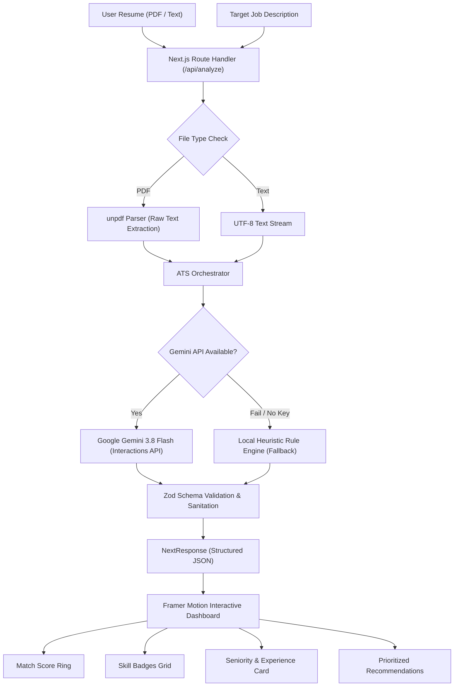

# CareerFit AI 🎯
### AI-Powered ATS Resume Scanner & Job Fit Matcher
**SWARA Proof of Work | Modern Next.js 16 • React 19 • Google Gemini AI**

[](https://nextjs.org/)
[](https://react.dev/)
[](https://www.typescriptlang.org/)
[](https://aistudio.google.com/)
[](https://tailwindcss.com/)
[](https://vercel.com/)

---

## 🌟 Executive Summary & SWARA Proof of Work

**CareerFit AI** is a state-of-the-art applicant tracking system (ATS) analyzer designed to bridge the gap between job seekers and hiring algorithms. Over 75% of resumes are filtered out by automated ATS software before reaching human recruiters due to formatting mismatches, missing domain keywords, and poorly articulated seniority alignment.

Built as an exemplary **Proof of Work for SWARA**, CareerFit AI delivers instant, multi-dimensional semantic evaluations of any resume against target job requirements, combining high-speed PDF text parsing with Google's next-generation **Gemini AI** (`gemini-3.8-flash`) and an automated fallback engine for 99.9% uptime.

---

## ⚡ Key Capabilities

- 📄 **Multi-Format Resume Intake**: Upload resumes in `.pdf` format with zero-dependency native parsing via `unpdf` or paste text directly. Includes pre-filled sample resume presets for instant testing.
- 🎯 **Target Job Alignment**: Paste custom job listings or select from pre-configured high-demand engineering roles (Senior Full-Stack, AI/ML Platform, Frontend Tech Lead).
- 📊 **Animated ATS Match Score**: Real-time visual progress ring scoring from 0% to 100%, categorized into *Excellent*, *Good*, *Fair*, or *Poor* fit.
- 🧩 **Semantic Skills Gap Analysis**:
  - **Matched Skills**: Highlights technologies, frameworks, and methodologies found in both documents in high-contrast emerald badges.
  - **Missing Critical Keywords**: Pinpoints vital requirements absent from the resume in soft rose badges to prevent ATS auto-rejection.
- 🎖️ **Seniority & Experience Check**: Verifies if the candidate's detected experience level (Junior, Mid, Senior, Lead) meets the job's stated requirements and flags seniority gaps with contextual explanations.
- 💡 **Actionable Optimization Recommendations**: Delivers 4-6 high-impact, actionable resume tweaks tailored specifically to the target role.
- 🛡️ **Dual-Engine Resilience**: Automated fallback to an offline heuristic analyzer if the AI API experiences network latency or quota restrictions.

---

## 🏗️ Architecture & Data Flow



---

## 🛠️ Technology Stack

| Layer | Technology | Purpose |
| :--- | :--- | :--- |
| **Framework** | **Next.js 16.4.5** (App Router & Turbopack) | Modern server components, optimized dynamic routing, and fast builds |
| **UI Library** | **React 19.2.4** | Latest React concurrent features and high-performance DOM reconciliation |
| **Styling** | **Tailwind CSS 4.x** | Precision dark-mode aesthetic with custom radial gradients and glassmorphism |
| **Animations** | **Framer Motion** | Fluid spring physics, layout transitions, and animated score rings |
| **AI Intelligence**| **Google GenAI SDK (`@google/genai`)** | Gemini Interactions API (`gemini-3.8-flash`) with structured JSON schema output |
| **Validation** | **Zod** | Runtime type safety and response schema guarantees |
| **Document Parsing**| **`unpdf`** | Lightweight, native Node.js and Edge-compatible PDF text extraction |
| **Icons** | **Lucide React** | Clean, accessible iconography |
| **Deployment** | **Vercel** | Global Edge CDN with zero-configuration serverless functions |

---

## 🤖 Google Gemini AI Integration

CareerFit AI leverages Google's flagship **`gemini-3.8-flash`** model via the official `@google/genai` SDK Interactions API to execute multi-step ATS evaluation:

```typescript
const interaction = await client.interactions.create({
  model: "gemini-3.8-flash",
  input: prompt,
  store: false,
  response_format: {
    type: "text",
    mime_type: "application/json",
  },
  generation_config: {
    temperature: 0.1, // Deterministic extraction
  },
});
```

### Response Schema Enforcement
Every response is strictly validated at runtime against our `AnalysisSchema`:
```typescript
{
  matchScore: number;          // 0-100%
  matchedSkills: string[];     // Array of shared competencies
  missingKeywords: string[];   // Critical missing ATS keywords
  seniorityFit: {
    level: "Junior" | "Mid" | "Senior" | "Lead" | "Unknown";
    isMatch: boolean;
    explanation: string;
  };
  recommendations: string[];   // Specific bulleted guidance
  summary: string;             // Holistic candidate assessment
  experienceYears: {
    required: string;
    detected: string;
  };
}
```

---

## 📸 Interface & User Experience Highlights

1. **Header & Hero**: Minimalist header with live API status badge, SWARA Proof of Work indicator, and quick-start actions.
2. **Dual-Input Workbench**:
   - *Left*: Drag-and-drop resume dropzone with file size/type validation, one-click preset loader, and text fallback switch.
   - *Right*: Target job editor with rapid presets for Full-Stack, AI Platform, and Frontend roles.
3. **Interactive Results Dashboard**:
   - Glowing circular gauge with matching score color transitions (Emerald $\ge 70\%$, Amber $\ge 40\%$, Crimson $< 40\%$).
   - Categorized skills breakdown featuring copyable tags.
   - Seniority parity badge with experience years reconciliation.
   - High-priority checklist to optimize resumes for corporate ATS systems (Workday, Greenhouse, Lever).

---

## 🚀 Getting Started

### Prerequisites
- **Node.js** 20.x or higher
- **pnpm** (recommended), npm, or yarn
- **Google Gemini API Key** (Free tier available at [Google AI Studio](https://aistudio.google.com/))

### 1. Clone the Repository
```bash
git clone https://github.com/thefarrukhdev/career-fit-ai.git
cd career-fit-ai
```

### 2. Install Dependencies
```bash
pnpm install
```

### 3. Configure Environment Variables
Copy the example environment configuration:
```bash
cp .env.local.example .env.local
```

Open `.env.local` and add your Gemini API key:
```env
GEMINI_API_KEY=your_gemini_api_key_here
```

*(Note: If no API key is provided, the application will automatically run in local heuristic fallback mode).*

### 4. Run Development Server
```bash
pnpm dev
```
Open [http://localhost:3000](http://localhost:3000) in your browser.

### 5. Production Build
```bash
pnpm build
pnpm start
```

---

## 🌐 Cloud Deployment (Vercel)

This project is optimized for 1-click deployment on **Vercel**:

1. Push your code to GitHub.
2. Import the repository into the [Vercel Dashboard](https://vercel.com/new).
3. Under **Environment Variables**, configure:
   - Key: `GEMINI_API_KEY`
   - Value: `your_gemini_api_key_here`
4. Click **Deploy**.

Alternatively, deploy directly from the CLI:
```bash
vercel --prod
```

---

## 📄 License & Credits

Developed with precision by **Farrukh Jumayev** ([@thefarrukhdev](https://github.com/thefarrukhdev)) for **SWARA**.
Licensed under the [MIT License](LICENSE).
